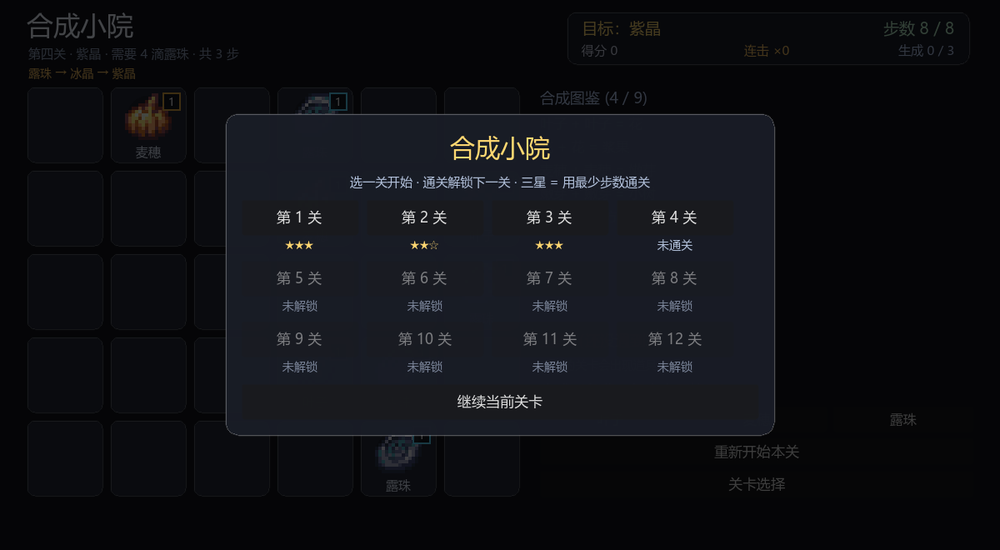
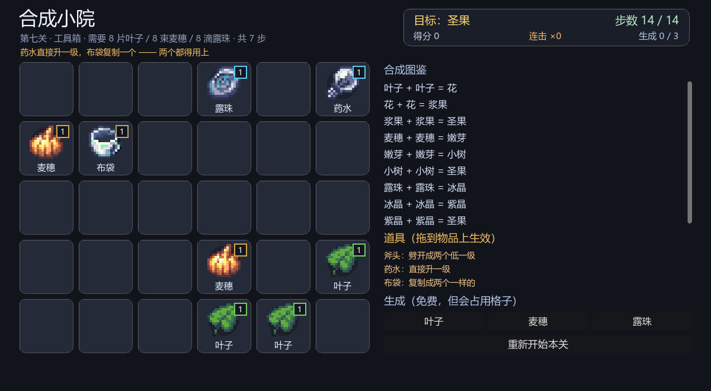

# 合成小院 · 拖拽合成小游戏

一个单场景、纯鼠标拖拽的合成小游戏。Godot 4.7 + GDScript，零第三方依赖。



## 运行

**用编辑器（推荐）**

1. 打开 Godot 4.7，点击「导入」，选中本目录下的 `project.godot`
2. 按 `F5` 运行

**用命令行**

```powershell
C:\Users\96103\Desktop\Godot_v4.7.2-stable_win64.exe --path . --editor --quit   # 首次：导入资源
C:\Users\96103\Desktop\Godot_v4.7.2-stable_win64.exe --path .                    # 直接运行
```

## 玩法

| 操作 | 结果 |
|------|------|
| 把 **两个相同物品** 拖到一起 | 合成升级（花 + 花 = 浆果） |
| 把物品拖到空格 | 移动，不消耗步数 |
| 把物品拖到**不同**物品上 | 交换位置，不消耗步数 |
| 把**道具**拖到物品上 | 道具生效（劈开 / 升级 / 复制），不消耗步数 |
| 点右侧「生成」按钮 | 免费造一件基础物品，但每关次数有限 |

- **背包 = 6×5 共 30 格**，物品不能重叠，每格最多一件
- **步数**：只有「合成」会扣步数。步数用完还没达成目标就失败
- **连击**：连续合成不断连，第 N 次连击得 `10 × N` 分；移动 / 交换 / 用道具都会断连击
- **星级**：三星 = 用这一关的**最少步数**通关，通关后解锁下一关
- 进度、星级、图鉴都存在 `user://save.json`，关掉游戏再回来还在

### 三条链，汇合到同一颗圣果

```
叶子 ×8 → 4 花  → 2 浆果 → 1 圣果
麦穗 ×8 → 4 嫩芽 → 2 小树 → 1 圣果
露珠 ×8 → 4 冰晶 → 2 紫晶 → 1 圣果
```

第二关三种基础物品各给 3 个，你得**先选一条路线**再补材料，选错了就得重开——这是第一个需要动脑的地方。

## 深度系统（12 关）

光靠「叠两个」很快就会腻，所以加了好几层决策：

### 1. 三种道具

道具摆在棋盘上，**拖到某个物品上**才生效（拖普通物品到道具上仍然只是交换）。道具不消耗步数——它本身就是「省步数」的价值。

| 道具 | 效果 | 什么时候有用 |
|------|------|--------------|
| 🔨 斧头 | 把一件物品**劈成两个低一级**（花 → 2 片叶子） | 基础材料不够时，把高级物品拆回原材料 |
| 🧪 药水 | 直接**升一级**（叶子 → 花） | 差一步就能合成时，一步到位 |
| 🎒 布袋 | **复制成两个一样的** | 材料差一点时凭空多出一件 |

> 斧头是唯一能**凭空增加基础材料数量**的道具，但总价值不变——它只改变材料的形状。所以它只在「要同时持有 N 个基础材料」这类目标里有意义。

### 2. 三种目标类型

| 类型 | 目标 | 例 |
|------|------|----|
| `make` | 合成出指定物品（可以同时要好几样） | 做出圣果 |
| `count` | **同时**拥有 N 个某物品 | 手上同时有 3 朵花 |
| `purge` | 把背包合成到只剩 N 件 | 8 片叶子合成到只剩 1 颗圣果 |

`count` 定义成「同时拥有」而不是「累计」，因为合成都走向上层，攒够 N 个低阶物品反而会让目标消失。`purge` 则要求把材料全部收敛成极少数高级物品——8 片叶子正好合成 1 颗圣果，**多一片都凑不出来**。

### 3. 生成器限次

生成器还是免费，但每关**可用次数有限**（右上角显示「生成 2 / 3」）。这让每关都有取舍：材料不够时，是省着合成，还是赌一次生成？第十关更是把生成器做成了陷阱——8 片叶子正好合成 1 颗圣果，多生成一片就再也合不回去了。

### 4. 连击与评分

连续合成有连击加成（第 N 次得 `10 × N` 分），追求高分会引导玩家规划合成顺序，而不是随手乱点。

### 5. 配方发现（图鉴）

右侧「合成图鉴」**开局是空的**——没合成过的配方不显示，只告诉你「还有 N 条配方没发现」。合成出来（或用道具试出来）才解锁一行。前几关会从「照着做」变成「自己试」。

道具同理：还没遇到的道具不会提前剧透，关卡标题会写「道具（还没遇到）」。

### 关卡一览

| 关 | 目标 | 步数 | 生成 | 道具 | 教什么 |
|----|------|------|------|------|--------|
| 一 · 四片叶子 | 做出浆果 | 8 | 2 | — | 基本合成 |
| 二 · 圣果（叶子路线） | 做出圣果 | 13 | 3 | — | 三条链选一条 |
| 三 · 小树 | 做出小树 | 8 | 3 | — | 换条链也能到圣果 |
| 四 · 紫晶 | 做出紫晶 | 8 | 3 | — | 第三条链 |
| 五 · 两样都要 | 浆果 + 小树 | 15 | 4 | — | 两个目标同时满足 |
| 六 · 三朵花 | 同时有 3 朵花 | 6 | 5 | — | `count` 目标：别合太快 |
| 七 · 工具箱 | 做出圣果 | 14 | 3 | 药水 + 布袋 | 两个道具**都得用上**才够材料 |
| 八 · 拆开重来 | 同时有 5 片叶子 | 6 | 0 | 斧头 | 斧头是唯一出路（这关没有生成器） |
| 九 · 整理背包 | 背包只剩 2 件 | 9 | 2 | — | `purge` 目标：两条链各收成一件 |
| 十 · 只剩一颗 | 背包只剩 1 件 | 10 | 2 | — | 8 片叶子刚好，生成器是陷阱 |
| 十一 · 满院堆料 | 做出圣果 | 7 | 0 | — | 院子里 18 件料，高阶材料就是捷径 |
| 十二 · 腾空 | 背包只剩 3 件 | 14 | 0 | — | 16 件收拾到 3 件，三条链各留一件 |

每关头部还有一行提示（橙色），告诉你这一关该注意什么。



## 美术素材

`_source/` 里是你放进来的素材包：

| 文件 | 内容 |
|------|------|
| `items.zip` | **主力**：1244 张 16×16 RPG 物品（武器/盔甲/宝石/食物/植物/材料），已解包到 `_source/extracted/` |
| `items_outdated.zip` | 早期的 105 张小合集 |
| `Free_pixel_food_16x16.zip` | 103 张 16×16 饮品/水果/蔬菜（**文件名可读**，`fruit_strawberry.png` 这种） |
| `Ghostpixxells_pixelfood.zip` | 102 张 32×32 熟食（披萨/汉堡/蛋糕） |
| `16x16 Weapons RPG Icons.zip` + 4 张 png | 武器合集 |

已从 `items.zip` 里挑出 13 张放进 `assets/items/`：

| 文件名 | 物品 | 等级 | 原始编号 |
|--------|------|------|----------|
| `leaf.png` | 叶子 | 1 | item994 |
| `wheat.png` | 麦穗 | 1 | item416 |
| `dew.png` | 露珠 | 1 | item1141 |
| `flower.png` | 花 | 2 | item1040 |
| `sprout.png` | 嫩芽 | 2 | item1002 |
| `crystal.png` | 冰晶 | 2 | item1131 |
| `berry.png` | 浆果 | 3 | item415 |
| `tree.png` | 小树 | 3 | item1003 |
| `gem.png` | 紫晶 | 3 | item1064 |
| `sacred_fruit.png` | 圣果 | 4 | item505 |
| `tool_axe.png` | 斧头（道具） | — | item815 |
| `tool_potion.png` | 药水（道具） | — | item949 |
| `tool_pouch.png` | 布袋（道具） | — | item810 |

> 全部选自 `items.zip` 是有意的——这套 1244 张风格统一（同一套描边和色调）。食物包虽然文件名更好读，但画风不同，混用会花。
>
> 以后想换成「食材 + 菜谱」那套开店玩法，`Free_pixel_food_16x16.zip` 里的 103 张文件名可读的食物是现成素材，而物品 id 和贴图本来就是分开的，换皮不用改逻辑。

**像素风的三处关键设置**（已配好，换素材不用改）：

1. `project.godot` → `rendering/textures/canvas_textures/default_texture_filter=0`（最近邻，**否则像素会被插值糊掉**）
2. `project.godot` → `rendering/2d/snap/snap_2d_transforms_to_pixel=true`（2D 变换对齐像素网格）
3. `scripts/item.gd` → 贴图按**整数倍**缩放（16px ×4 = 64px），非整数倍会让像素大小不均

想换图：按上表命名放进 `assets/items/`，回编辑器自动导入替换。**必须是 16×16 的正方形透明 PNG**，比例不一致会被拉成非整数倍。

想要全量素材索引图看 `docs/sheet_0.png` ~ `docs/sheet_3.png`（1244 张全览，带编号）。

## 目录结构

```
my-game/
├── project.godot          工程配置（主场景、中文字体、像素过滤、窗口尺寸）
├── icon.svg               应用图标
├── scenes/
│   └── Main.tscn          唯一的场景：HUD + 棋盘 + 侧栏 + 结算面板
├── scripts/
│   ├── game_data.gd       ★ 物品表 / 道具表 / 配方表 / 关卡表，改数值只动这里
│   ├── save_data.gd       本地存档（user://save.json）：星级 / 解锁 / 图鉴
│   ├── item.gd            物品节点：整数倍像素缩放 + 弹跳动画 + 无贴图时的代码占位图形
│   ├── board.gd           棋盘：格子、拖拽、合成 / 交换 / 移动 / 道具判定
│   └── main.gd            主流程：关卡、HUD、目标判定、生成限次、连击评分、结算、关卡选择
├── assets/
│   ├── fonts/ui_font.tres 系统字体（微软雅黑等），保证中文不显示成方块
│   └── items/             ★ 物品贴图（16×16 PNG）
├── _source/               原始素材包（已用 .gdignore 排除，不参与导入）
├── tools/
│   ├── run.ps1            ★ 跑测试 / 截图的脚本（Godot 是 GUI 程序，不重定向就看不到输出）
│   ├── test_game.gd       自动化测试（146 项）
│   ├── contact_sheet.gd   生成 1244 张素材的编号索引图
│   ├── zoom_candidates.gd 放大对照图，用来挑素材
│   └── shot.gd            批量截图
└── docs/                  截图与素材索引
```

## 扩展

**加一件物品**（`scripts/game_data.gd`）

```gdscript
# ITEMS 里加一行
"star": {"name": "星星", "tier": 5, "unit": "颗", "shape": "star", "color": "#ffe066"},
# RECIPES 里加一条（两边必须相同）
"mushroom+mushroom": "star",
```

`shape` 可选：`circle` `oval` `square` `pill` `triangle` `diamond` `hexagon` `star` `drop` `blossom`——只在**没放贴图**时用作占位图形。

**加一关**（`scripts/game_data.gd` 的 `LEVELS`）

```gdscript
{
    "name": "第十三关 · 星星",
    "objective": {"type": "make", "items": ["star"]},
    "moves": 12,
    "gen_limit": 2,
    "best": 8,                      # 这关最少几步（三星线）
    "start": ["mushroom", "mushroom", "leaf", "leaf"],
    "tools": [],
    "hint": "这里可以写给玩家的一句话提示",
},
```

| 字段 | 说明 |
|------|------|
| `objective.type` | `make`（做出某物）/ `count`（同时有 N 个）/ `purge`（背包只剩 N 件） |
| `objective.items` | `make` 用：要的物品 id，可多个；`count` 用：数哪个 |
| `objective.n` | `count` 用：要同时有几个 |
| `objective.left` | `purge` 用：背包剩几件算赢 |
| `moves` | 允许的合成次数 |
| `best` | **这一关最少需要几次合成**——三星线，写准了星级才有意义 |
| `gen_limit` | 生成器可用次数 |
| `start` | 开局背包内容 |
| `tools` | 开局摆在棋盘上的道具 id |
| `hint` | 关卡提示（可省略） |

> 加了带 `class_name` 的脚本后，第一次跑要先进编辑器导入一次（`--editor --quit`），否则无头模式下全局类名没注册。

## 开发工具

```powershell
# 一站式脚本（推荐）：Godot 是 GUI 子系统程序，直接调用看不到任何输出
powershell -ExecutionPolicy Bypass -File tools\run.ps1 test     # 跑自动化测试
powershell -ExecutionPolicy Bypass -File tools\run.ps1 shot 7   # 第 8 关截图
powershell -ExecutionPolicy Bypass -File tools\run.ps1 shot menu # 关卡选择面板截图
powershell -ExecutionPolicy Bypass -File tools\run.ps1 import  # 重新导入资源
powershell -ExecutionPolicy Bypass -File tools\run.ps1 headless # 无头跑 120 帧查报错

# 原始命令（输出得自己重定向到文件才看得到）
C:\Users\96103\Desktop\Godot_v4.7.2-stable_win64.exe --headless --path . --script res://tools/test_game.gd
```

自动化测试覆盖：配方表合法性、升级/降级映射一致性、12 关关卡表字段、13 张贴图完整性、合成 / 移动 / 交换、连击与评分、生成器限次、三种道具效果、`count` / `purge` 目标判定、每关「开局不应直接过关」、**星级 / 存档 / 关卡解锁 / 配方发现 / 新档首次启动**，以及**第七、八、十一、十二关的完整通关解法**（保证关卡真的解得开）。共 146 项，全部通过时输出 `ALL TESTS PASSED`。

> 测试会把自己的存档路径改成 `user://test_save.json`，**不会动你的真实存档**；截图工具用 `user://shot_save.json`，同理。

## 一些取舍

- **中文字体用的是系统字体**（微软雅黑 / 苹方 / 思源黑体按顺序找），不打包字体文件，体积小；代价是换到没装中文字体的系统会显示方块，而且它是矢量字体，跟像素图标放一起会有点违和——想彻底统一风格可以换成像素中文字体（如方正像素字体）
- **合成严格限定「相同物品 + 相同物品」**，所以不同物品之间只会交换位置，不会误合成
- **道具不消耗步数**——道具的价值就是省步数，所以不能再收一遍步数费
- **`count` 目标定义为「同时拥有」**，不是累计，否则合成到高层级后目标会自己消失
- **斧头不增加总价值**，只改变材料形状，所以它对 `purge` 类目标没用，只对「要同时持有 N 个基础材料」有用
- **星级按每关的 `best` 校准**，不用「总步数 × 35%」那种拍脑袋的算法——否则第九、十关完美通关反而只有 2 星
- 结算面板、关卡选择面板都在**同一个场景**里用 `visible` 切换，没有额外场景文件
- `_source/` 下有 `.gdignore`，Godot 不会去导入那 1244 张图，工程保持干净

## 两个踩过的坑（改代码前先看一眼）

1. **`Script.is_tool()` 是引擎内置方法**（判断脚本是不是 `@tool`）。在 `GameData` 里定义同名静态函数 `is_tool()` 会静默被遮蔽，调用时报 "Expected 0 argument(s)"。所以道具判断叫 `is_tool_item()`。
2. **Godot 是 Windows GUI 子系统程序**，`& $godot ...` 的 stdout/stderr 不会挂到控制台，报错信息全部丢失。脚本中途出错时进程还会一直空转到超时。`tools/run.ps1` 把输出重定向到文件再打印出来，才能看到「哪一行报错了」。
